# NeuroClaw

<p align="center"></p>

<p align="center">A local-first AI agent on your own computer, powered by <b>OneBrain</b>, a neural mesh engine.<br>No account, no cloud, no tokenizer.</p>

> **This is an educational project in beta. Please spread the word.**
> WE ARE NOT RESPONSIBLE FOR YOUR ACTIONS OR WHAT THE CODE DOES. BY CONTINUING YOU AGREE WITH THIS STATEMENT AND THE [PRIVACY POLICY](PRIVACY.md) AND [TERMS AND CONDITIONS](TERMS.md).

## Download

Click a button. Open it like any other app: no terminal, no browser.

<table>
<tr>
<td><b>Linux</b><br><sub>Debian, Ubuntu, Chromebook Linux</sub></td>
<td><a href="https://github.com/zach909/my-ai/releases/latest/download/neuroclaw-linux-x64.deb"></a></td>
<td><a href="https://github.com/zach909/my-ai/releases/latest/download/neuroclaw-linux-x64.tar.gz"></a></td>
</tr>
<tr>
<td><b>Windows</b><br><sub>installs for you only</sub></td>
<td><a href="https://github.com/zach909/my-ai/releases/latest/download/neuroclaw-windows-x64.exe"></a></td>
<td><a href="https://github.com/zach909/my-ai/releases/latest/download/neuroclaw-windows-x64.zip"></a></td>
</tr>
<tr>
<td><b>macOS</b><br><sub>Apple silicon</sub></td>
<td><a href="https://github.com/zach909/my-ai/releases/latest/download/neuroclaw-macos-arm64.dmg"></a></td>
<td><a href="https://github.com/zach909/my-ai/releases/latest/download/neuroclaw-macos-arm64.zip"></a></td>
</tr>
<tr>
<td><b>Android</b><br><sub>sideload</sub></td>
<td><a href="https://github.com/zach909/my-ai/releases/latest/download/neuroclaw-android-any.apk"></a></td>
<td></td>
</tr>
<tr>
<td><b>Chrome / Chromebook</b><br><sub>extension</sub></td>
<td><a href="https://github.com/zach909/my-ai/releases/latest/download/neuroclaw-chrome-extension.zip"></a></td>
<td></td>
</tr>
</table>

<p>No installer yet? <a href="https://github.com/zach909/my-ai/archive/refs/heads/main.zip"></a> (the code, to run with <code>npm run app</code>)</p>

iPhone and iPad: not available yet. All platforms and what each can do: [docs/PLATFORMS.md](docs/PLATFORMS.md).

## What it does

Open [`docs/index.html`](docs/index.html) in a browser for the full animated page. Here is the same thing in pictures:

<table>
<tr>
<td></td>
<td></td>
</tr>
<tr>
<td></td>
<td></td>
</tr>
<tr>
<td></td>
<td></td>
</tr>
</table>

<!-- wiki-animations:start -->
## The wiki in motion

Every page in the [wiki](wiki/Home.md) has its own animation. Click one to open the page. The animations are generated by [scripts/make-wiki-animations.mjs](scripts/make-wiki-animations.mjs) and live in [docs/media/wiki/](docs/media/wiki/).

### Start here

<table>
<tr>
<td><a href="wiki/Home.md"></a><br><sub><b>Home</b></sub></td>
<td><a href="wiki/Quick-Start.md"></a><br><sub><b>Quick Start</b></sub></td>
</tr>
<tr>
<td><a href="wiki/Architecture.md"></a><br><sub><b>Architecture</b></sub></td>
<td><a href="wiki/AI-OS-Mode.md"></a><br><sub><b>AI OS mode</b></sub></td>
</tr>
<tr>
<td><a href="wiki/Visuals.md"></a><br><sub><b>Visuals</b></sub></td>
<td></td>
</tr>
</table>

### Background

<table>
<tr>
<td><a href="wiki/Quantization.md"></a><br><sub><b>Quantization</b></sub></td>
<td><a href="wiki/Elastic-Value-Budget.md"></a><br><sub><b>Elastic Value Budget</b></sub></td>
</tr>
<tr>
<td><a href="wiki/Wake-Sleep-Islands.md"></a><br><sub><b>Wake-Sleep Islands</b></sub></td>
<td><a href="wiki/Grow-Prune-Quantize.md"></a><br><sub><b>Grow, Prune, Quantize</b></sub></td>
</tr>
<tr>
<td><a href="wiki/Extensions.md"></a><br><sub><b>Self-Built Extensions</b></sub></td>
<td><a href="wiki/RLM.md"></a><br><sub><b>RLM</b></sub></td>
</tr>
<tr>
<td><a href="wiki/Empathy-Engine.md"></a><br><sub><b>Empathy Engine</b></sub></td>
<td><a href="wiki/Imagination.md"></a><br><sub><b>Imagination</b></sub></td>
</tr>
</table>

### Foreground

<table>
<tr>
<td><a href="wiki/MoE.md"></a><br><sub><b>Net-Skill Routing</b></sub></td>
<td><a href="wiki/Auto-Route.md"></a><br><sub><b>Auto Route</b></sub></td>
</tr>
<tr>
<td><a href="wiki/Neuron-Mesh.md"></a><br><sub><b>Neuron Mesh</b></sub></td>
<td><a href="wiki/Hyperdimensional.md"></a><br><sub><b>Hyper-Dimensional Thinking</b></sub></td>
</tr>
<tr>
<td><a href="wiki/Zip-IO.md"></a><br><sub><b>Zip I/O Loop</b></sub></td>
<td><a href="wiki/Quantum-Net.md"></a><br><sub><b>Quantum Neural Net</b></sub></td>
</tr>
<tr>
<td><a href="wiki/Prompt-Memory.md"></a><br><sub><b>Prompt Memory</b></sub></td>
<td><a href="wiki/Zip-Workspace.md"></a><br><sub><b>Zip Workspace (draft)</b></sub></td>
</tr>
<tr>
<td><a href="wiki/Yes-No-Questions.md"></a><br><sub><b>Yes/No Questions</b></sub></td>
<td><a href="wiki/Net-Search.md"></a><br><sub><b>Net Search</b></sub></td>
</tr>
<tr>
<td><a href="wiki/Referee.md"></a><br><sub><b>Referee</b></sub></td>
<td></td>
</tr>
</table>

### Extension system

<table>
<tr>
<td><a href="wiki/Builder.md"></a><br><sub><b>Extension Builder</b></sub></td>
<td><a href="wiki/Plugins.md"></a><br><sub><b>Plugins</b></sub></td>
</tr>
<tr>
<td><a href="wiki/Skills.md"></a><br><sub><b>Skills</b></sub></td>
<td><a href="wiki/Code-to-Net.md"></a><br><sub><b>Code-to-Net</b></sub></td>
</tr>
<tr>
<td><a href="wiki/Net-Maker.md"></a><br><sub><b>Net Maker</b></sub></td>
<td><a href="wiki/Map-Maker.md"></a><br><sub><b>Map Maker</b></sub></td>
</tr>
<tr>
<td><a href="wiki/Task-Training.md"></a><br><sub><b>Task Training</b></sub></td>
<td><a href="wiki/Knowledge-Training.md"></a><br><sub><b>Knowledge Training</b></sub></td>
</tr>
<tr>
<td><a href="wiki/Format-Converter.md"></a><br><sub><b>Format Converter</b></sub></td>
<td><a href="wiki/Memory-Topics.md"></a><br><sub><b>Memory Topics</b></sub></td>
</tr>
<tr>
<td><a href="wiki/Chrome-Apps.md"></a><br><sub><b>Chrome Apps</b></sub></td>
<td></td>
</tr>
</table>

### Reference

<table>
<tr>
<td><a href="wiki/NeuroLang.md"></a><br><sub><b>NeuroLang</b></sub></td>
<td><a href="wiki/Syntax.md"></a><br><sub><b>NeuroLang Syntax</b></sub></td>
</tr>
<tr>
<td><a href="wiki/Languages.md"></a><br><sub><b>Supported Languages</b></sub></td>
<td><a href="wiki/Pipeline.md"></a><br><sub><b>Pipeline Flow</b></sub></td>
</tr>
</table>

### System and safety

<table>
<tr>
<td><a href="wiki/Platforms.md"></a><br><sub><b>Platform Support</b></sub></td>
<td><a href="wiki/System-Access.md"></a><br><sub><b>System Access</b></sub></td>
</tr>
<tr>
<td><a href="wiki/Multi-Input.md"></a><br><sub><b>Multi-Input Support</b></sub></td>
<td><a href="wiki/Privacy.md"></a><br><sub><b>Privacy and Security</b></sub></td>
</tr>
<tr>
<td><a href="wiki/Privacy-Policy.md"></a><br><sub><b>Privacy Policy</b></sub></td>
<td><a href="wiki/Terms.md"></a><br><sub><b>Terms</b></sub></td>
</tr>
</table>

### Operations

<table>
<tr>
<td><a href="wiki/Self-Improvement.md"></a><br><sub><b>Self-Improvement</b></sub></td>
<td><a href="wiki/Bots.md"></a><br><sub><b>Automated Bots</b></sub></td>
</tr>
</table>

### Sharing and community

<table>
<tr>
<td><a href="wiki/Sharing.md"></a><br><sub><b>Sharing</b></sub></td>
<td><a href="wiki/Commons.md"></a><br><sub><b>Commons</b></sub></td>
</tr>
</table>
<!-- wiki-animations:end -->
## Run it from source

```bash
npm run app        # build and open it in its own window
npm run package    # build the installer for your system into release-artifacts/
```

## Project Structure

### Top-level overview

- **Local-First OneBrain Engine (`OneBrainEngine.kt`, `OneBrainModel.kt`, `HDVector.kt`)**:
  - **One model, one engine**: `OneBrainModel` holds everything OneBrain knows (byte graph, hyperdimensional mesh, Vale ledger, skill regions, memories, Yes/No examples) and is the only place it is loaded, merged and exported. `OneBrainEngine` is the only thing that runs it, and Chat's Yes/No hint and the Yes/No Trainer share a single scorer.
  - Loads bundled OneBrain byte-transition graph (`memory_input_b*` → `memory_output_b*`).
  - Encodes UTF-8 bytes directly into partitioned hyperdimensional vectors (`sem`, `ctx`, `val`, `tmp`, `meta`) with zero-sum Vale plasticity conservation across 32 hyper-neurons × 32 dimensions.
  - Consolidates surprise-gated associative memories and routes requests to active skill regions.
- **NeuroLang Builder, Store & Wiki (`NeuroLangParser.kt`, `BuilderScreen.kt`)**:
  - Compiles `name=`, `@vale=`, `@definition=`, and `@connections=` blocks directly on device, grafting new skill regions into OneBrain.
  - Includes a curated built-in Skill Store and offline Wiki.
- **Metrics & Yes/No Doorway (`MetricsScreen.kt`)**:
  - Live Vale distribution bars, OneBrain diagnostics, capability drills (Hyperdim, Vale, NeuroLang, ZipLoop), and on-device Yes/No classification training.
- **Commons, Alignment & DeviceTools (`CommonsScreen.kt`, `DeviceTools.kt`)**:
  - Danger Protocols alignment standing meter, Sandbox guard, Self-Healing checks, Data Donor toggles, and Compute Lending leases.
  - **DeviceTools** registered in OneBrain and runnable from Chat (`Tools` sheet or `tool: <name>`) or Commons: `permission_audit`, `device_info`, `network_status`, `battery_status`, `sensor_status`, `get_location`, `list_contacts`, `list_calendar_events`, `bluetooth_status`, `dial_number`, `compose_sms`, `compose_email`, `open_app_settings`, plus zero-permission Photo Picker (`PickVisualMedia`) and Document Picker (`OpenDocument`).
- **Warm Dark Coral + Crown Ring Ambient (`CrownRingAmbient.kt`)**:
  - Compose Canvas 2D 3D-projected 6-rise/6-dip Coral Crown Ring around the Shoggoth mascot with animated green skill tentacles for active mesh regions.
- **Optional PC Sync (`SyncClient.kt`, `SettingsScreen.kt`)**:
  - Everything runs locally on-device without a server; optionally connect to a NeuroClaw PC host via `/api/phone-sync` and `/api/captures`.

## Atlas: a map of anything (`atlas/`)

Put data in space so redundant data collapses and good data is kept: notes, files of any kind, numbers about anything
(how many people liked a video, a smell, a temperature), depth from two cameras. `install.sh` installs it as
`neuroclaw-atlas` with a private data folder; live cameras stay off until you run `neuroclaw-atlas capture on`, and nothing
is started, scheduled or enabled at boot. **Map prompts** (on by default; `neuroclaw-atlas prompts off` stops them) let the
mapper ask the agent for help by itself when it notices something, such as a nearly flat battery or a program opening the
camera; the agent's normal approval gate still holds every risky tool. See [`atlas/README.md`](atlas/README.md).
Tests: `python3 -m unittest discover -s tests/atlas`, `node --test test/platform/map-prompts.test.mjs`.
```
├── .bin/                    # Symlinks to the TypeScript compiler (tsc, tsserver) in node_modules
├── .claude/                 # Claude Code local permission settings
├── asi_core/                # Python reference implementation of the brain (stdlib only) + its unit tests
├── benchmarks/              # Bun/TS performance benchmarks for the OneBrain engine
├── config/                  # Runtime config: access grants, quantization, routing, optimization baselines
├── desktop-app/             # Electron desktop wrapper (macOS / Windows / Debian)
├── dist/                    # Compiled JavaScript output of the TypeScript backend (tsc → dist/)
├── docs/                    # Design specs, guides, and status documents
├── extension-builder/       # Extension Builder engine, network build/training scripts, and trained artifacts
├── extension_system/        # TypeScript extension lifecycle, versioning, permissions, and storage
├── generated/               # Skills and plugins the AI wrote for itself, plus their wiki pages
├── interface/               # Backend entry point, HTTP API server, CLI, and OS-access layer
├── live-usb/                # Debian live-build config for a bootable NeuroClaw USB image
├── model && skills manager/ # Python NeuroLang DSL/runtime and legacy TinyGPT-era files
├── models && skills/        # The TypeScript AI engine (OneBrain) and every core subsystem
├── plugin_manager/          # Plugin registry, loader, SDK, and capability router (TS + Python)
├── plugins/                 # Every plugin (camera, email, terminal, store, …) in TS and Python
├── public/                  # Static files served as-is by Vite (icons, robots.txt, sitemap)
├── scripts/                 # Dev/server launchers, autonomous agents, exams, build helpers
├── src/                     # React frontend (TanStack Start + Vite) plus a few backend-shared libs
├── test/                    # Vitest suites for the TypeScript stack, plus smoke + install tests
├── tests/                   # Python security test suite for the Python plugins
├── training_data/           # Scientific-database catalog and its loader
└── wiki/                    # Architecture wiki (source of the GitHub wiki)
```

### Every subfolder

| Folder | What it holds |
|---|---|
| `desktop-app/assets/` | App icons for each OS. |
| `desktop-app/scripts/` | Preflight `doctor.mjs`, run before Electron starts. |
| `desktop-app/src/main/` | Electron main process and local app server. |
| `desktop-app/src/preload/` | Secure preload bridge. |
| `desktop-app/src/renderer/` | Boot screen and fallback renderer HTML. |
| `desktop-app/test/` | Desktop app tests. |
| `dist/extension-builder/` | Compiled `extension-builder/`. |
| `dist/extension_system/` | Compiled `extension_system/`. |
| `dist/interface/` | Compiled `interface/`. Contains the backend entry point `main.js`. |
| `dist/models && skills/` | Compiled top-level `models && skills/` modules. |
| `dist/models && skills/core/` | Compiled OneBrain engine and core subsystems. |
| `dist/plugin_manager/` | Compiled `plugin_manager/`. |
| `dist/plugins/` | Compiled plugins. |
| `dist/plugins/extensions/` | Compiled built-in extensions. |
| `dist/src/` | Compiled backend-shared `src/index.ts`. |
| `dist/src/lib/` | Compiled backend-shared `src/lib/` helpers. |
| `dist/src/server/` | Compiled `bot-service.ts`. |
| `docs/architecture/` | Implementation-level architecture docs (background quantization). |
| `extension-builder/checkpoints/` | Saved network checkpoints. |
| `extension-builder/extensions/` | Extension records (mostly leftovers from tests). Built `.ext.json` files land here but are gitignored. |
| `extension-builder/installed/skills/` | Installed-skills location. It currently holds only a path-traversal test fixture. |
| `generated/plugins/` | Plugins the AI generated (`.ts` + manifest). |
| `generated/plugins-wiki/` | Wiki pages for the generated plugins. |
| `generated/skills/` | Skills the AI generated (`.neuri` NeuroLang). |
| `generated/skills-wiki/` | Wiki pages for the generated skills. |
| `live-usb/config/` | Debian live-build configuration tree. |
| `live-usb/config/hooks/live/` | Build-time chroot hooks. |
| `live-usb/config/includes.chroot/` | Files copied verbatim into the live filesystem. |
| `live-usb/config/includes.chroot/etc/skel/` | Home-directory dotfiles for the live user (kiosk autostart). |
| `live-usb/config/includes.chroot/etc/skel/.config/openbox/` | Openbox autostart that launches the kiosk browser. |
| `live-usb/config/includes.chroot/etc/systemd/system/` | systemd unit that runs NeuroClaw. |
| `live-usb/config/includes.chroot/etc/systemd/system/multi-user.target.wants/` | Symlink that enables the unit at boot. |
| `live-usb/config/package-lists/` | Debian packages installed into the image. |
| `model && skills manager/data/` | Sample data from the TinyGPT era. |
| `model && skills manager/data/pretrain/` | Sample pretraining corpus. |
| `model && skills manager/data/sft/` | Sample fine-tuning chats. |
| `model && skills manager/interface/` | Legacy TinyGPT chat server. |
| `models && skills/core/` | OneBrain engine and every core subsystem (memory, reasoning, store, access, …). |
| `models && skills/self_ext_*/` | 14 self-authored memory-extension snapshots (generations 5–70). |
| `plugins/extensions/` | Built-in extensions (Coding, SkillMaker, PluginMaker, …). |
| `scripts/drill-generators/` | Problem generators for the skill-drill agent. |
| `scripts/exam-generators/` | Question generators for the capability exam. |
| `scripts/patches/` | Old one-off source patch scripts. Most target files that no longer exist. |
| `src/assets/` | Images bundled into the frontend. |
| `src/components/` | Shared React components. |
| `src/components/charts/` | Hand-written chart component. |
| `src/components/ui/` | shadcn/ui primitives. |
| `src/features/` | Feature modules. |
| `src/features/builder/` | Extension Builder UI. |
| `src/features/mesh/` | In-browser mesh engine and 3D visualization. |
| `src/hooks/` | React hooks. |
| `src/layouts/` | Layout components. |
| `src/lib/` | Frontend utilities, some of them shared with the backend. |
| `src/routes/` | File-based TanStack routes. |
| `src/routes/app/` | Pages under `/app` (chat, store, settings, …). |
| `src/server/` | Chat bot service. |
| `test/core/` | Vitest suites for each subsystem and plugin. |
| `tests/` | Python test root. |
| `tests/security/` | Python plugin security tests. |
| `wiki/bot/` | Wiki pages published through the API. |

### Every file and folder, explained

Every tracked file in the repository is listed below, grouped by folder. Paths are relative to the repo root.

#### Root files

| File | What it does |
|---|---|
| `.gitattributes` | Routes binary media (images, video, audio, fonts, PDFs) through Git LFS. |
| `.gitconfig` | Marks `/home/user` as a git `safe.directory` so git works inside containers. |
| `.gitignore` | Ignores build output, `node_modules`, logs, env files, archives, and runtime-generated state. |
| `.stylelintrc.json` | Stylelint rules for `src/**/*.css`. It allows Tailwind v4 at-rules such as `@theme`, `@apply`, and `@utility`. |
| `AGENTS.md` | Instructions for AI coding agents: how to run the Docker dev environment and how to check that it works. |
| `PRIVACY.md` | Short pointer to the full privacy policy in `wiki/Privacy-Policy.md` and `wiki/Privacy.md`. |
| `README.md` | This file: project overview, quick start, and the complete file map. |
| `STRUCTURE.md` | Older folder-level structure document and naming conventions. |
| `TERMS.md` | Short pointer to the full terms of use in `wiki/Terms.md`. |
| `bun.lock` | Bun lockfile for Node dependencies. |
| `components.json` | shadcn/ui config: style, Tailwind CSS path, and the `@/` import aliases. |
| `docker-compose.dev.yml` | One-service Docker Compose dev setup (`node:22-slim`). It runs `npm install && npm run dev` with the backend on 7861, published on the host as both 7861 and 3000. |
| `eslint.config.js` | ESLint flat config, scoped to `src/` (React hooks and react-refresh rules). |
| `package.json` | Node package manifest. It defines the scripts (`dev`, `server`, `build`, `lint`, `test`, `bench:*`) and the dependencies. |
| `package-lock.json` | npm lockfile. |
| `pnpm-lock.yaml` | pnpm lockfile. |
| `requirements.txt` | Top-level Python requirements. It is deliberately empty because the Python mesh uses only the standard library, and the file explains why. |
| `tsconfig.json` | TypeScript config for the React frontend (`src/`). |
| `tsconfig.backend.json` | TypeScript config for the Node backend. It compiles `models && skills/`, `interface/`, `plugins/`, `plugin_manager/`, `extension_system/`, and a few `src/` files into `dist/`. |
| `tsconfig.node.json` | TypeScript config for Node-side tooling files such as `vite.config.ts`. |
| `twisted_metal_strip.obj` | Wavefront 3D mesh of the twisted-metal-strip logo. |
| `twisted_metal_strip_3pt_profile.html` | Standalone Three.js page that renders the twisted-strip logo. It is the origin of `src/components/twisted-strip-geometry.ts`. |
| `vite.config.ts` | Vite + TanStack Start config: dev server on port 3000, `/api` proxy to the backend on 7861, a plugin that keeps global CSS imported, and build settings. |
| `vitest.config.ts` | Vitest config for the backend test suites in `test/`. It is kept separate from `vite.config.ts` on purpose. |

#### `.bin/`

| File | What it does |
|---|---|
| `.bin/tsc` | Symlink to `node_modules/typescript/bin/tsc`, used by the backend build. It only works after `npm install`. |
| `.bin/tsserver` | Symlink to `node_modules/typescript/bin/tsserver` (the TypeScript language server). |

#### `.claude/`

| File | What it does |
|---|---|
| `.claude/settings.local.json` | Claude Code permission allowlist for commands used while developing, such as `npx tsx index.ts cli`. |

#### `asi_core/` — Python reference brain

Pure-Python, stdlib-only implementation of the brain. Run the tests with `python3 -m unittest discover -s asi_core -v`. It is not part of the web runtime.

| File | What it does |
|---|---|
| `asi_core/__init__.py` | Package entry point. It re-exports the public API (`NeuralMesh`, `UnifiedBrain`, `create_brain`, …). |
| `asi_core/action_log.py` | Action log and human-approval gate. It records what the AI did, why, and which system did it, and holds actions that match approval rules. |
| `asi_core/background_quantization.py` | Pure-Python quantizer (float → int4 with scale and zero-point) plus a "billing" step that quantizes finished extensions. |
| `asi_core/circular_context.py` | Circular context buffers. Items evicted from the buffer are compressed into memory instead of being dropped. |
| `asi_core/endurance_training.py` | Long-running training harness for `UnifiedBrain`: a curriculum across all expert domains, with checkpointing and resume. |
| `asi_core/extension_system.py` | Versioned extensions that bundle learned skills. Each one goes through the lifecycle created → tested → optimized → quantized. |
| `asi_core/hive_mind.py` | Multi-agent sharing of extensions between brains. Shared extensions are re-verified before they are accepted, and each agent has a trust score. |
| `asi_core/hyperdim_thinking.py` | Hyperdimensional thinking: HD vector algebra (bind, bundle, permute), per-neuron state, surprise-gated memory, and analogy reasoning. |
| `asi_core/mistake_tracker.py` | Records why each mistake happened and lowers the value of patterns that keep repeating mistakes. |
| `asi_core/neural_core.py` | Stage-1 neural core: neurons, layers, synapses, Hebbian learning, and STDP. |
| `asi_core/neural_dsl.py` | Neural Definition Language (NDL): parses and executes text neuron definitions (`name=`, `@vale=`, `@definition=`, connections). |
| `asi_core/neural_mesh.py` | The all-to-all neural mesh: D-dimensional neuron states, zero-sum vale, expert groups, and optional multi-process parallel settle. |
| `asi_core/neural_states.py` | Neural state vectors and plasticity rules (Hebbian, STDP, homeostatic), plus state persistence. |
| `asi_core/unified_brain.py` | `UnifiedBrain`: connects the mesh, vale, HD thinking, and learning into one pipeline (input → state → memory → reasoning → skills → output → learning). |
| `asi_core/vale_system.py` | Background Value (vale) system: a strictly zero-sum stability budget in which high-vale neurons change slowly. |
| `asi_core/test_action_log.py` | Tests for `action_log.py`. |
| `asi_core/test_background_quantization.py` | Tests for `background_quantization.py`. |
| `asi_core/test_circular_context.py` | Tests for `circular_context.py`. |
| `asi_core/test_endurance_training.py` | Tests for `endurance_training.py`. |
| `asi_core/test_extension_system.py` | Tests for `extension_system.py`. |
| `asi_core/test_hive_mind.py` | Tests for `hive_mind.py`. |
| `asi_core/test_hyperdim_thinking.py` | Tests for `hyperdim_thinking.py`, organized section by section to match `docs/HYPERDIMENSIONAL_THINKING.md`. |
| `asi_core/test_mistake_tracker.py` | Tests for `mistake_tracker.py`. |
| `asi_core/test_neural_core.py` | Tests for `neural_core.py` and `neural_states.py`. |
| `asi_core/test_neural_dsl.py` | Tests for the NDL parser and executor. |
| `asi_core/test_neural_mesh.py` | Tests for `neural_mesh.py`: connectivity, vale, settle, learning, persistence, and parallel equivalence. |
| `asi_core/test_unified_brain.py` | Tests for `unified_brain.py`. |
| `asi_core/test_vale_system.py` | Tests for `vale_system.py`: conservation, bounds, plasticity, and serialization. |

#### `benchmarks/`

| File | What it does |
|---|---|
| `benchmarks/README.md` | How to run each benchmark (`bun run bench`, `bench:*`). |
| `benchmarks/hyper_benchmark.ts` | Times `HyperDimensionalEngine` propagation. |
| `benchmarks/memory_benchmark.ts` | Times `LongTermMemory` recall over 1,000 stored items. |
| `benchmarks/mesh_benchmark.ts` | Times serial `NeuronMesh.propagate()` on a 200-node mesh. |
| `benchmarks/mesh_parallel_benchmark.ts` | Compares serial and `MeshWorkerPool` (worker_threads) propagation on a mesh large enough for parallelism to pay off. |
| `benchmarks/moe_benchmark.ts` | Times `MoERouter` expert routing. |
| `benchmarks/quantizer_benchmark.ts` | Times bit-packing and unpacking (`packLevels`/`unpackLevels`) at different bit widths. |
| `benchmarks/rlm_benchmark.ts` | Times `RLMTrainer` experience replay and training. |

#### `config/`

| File | What it does |
|---|---|
| `config/Icon.obj` | 3D model of the app icon. It is a byte-for-byte duplicate of the root `twisted_metal_strip.obj`. |
| `config/access.json` | Saved computer-access kill switches and capability grants (read by `access-settings.ts`). |
| `config/encryption.salt` | Binary salt for deriving encryption keys for encrypted local data. |
| `config/optimization-baseline.json` | Baseline metric values that the optimization agent (`scripts/optimize-agent.mjs`) compares against. |
| `config/optimization-report.json` | Latest report from the optimization agent: each check's value and what it removed or flagged. |
| `config/quantization.json` | Background quantization settings: bit width, method, mode, and mixed-precision rules. |
| `config/routing.json` | Learned routing evidence: per-token weights that map words to plugins, used by the capability router. |

#### `desktop-app/` — Electron wrapper

| File | What it does |
|---|---|
| `desktop-app/.gitignore` | Ignores `.staged-dist/`, the web build copied in before packaging. |
| `desktop-app/README.md` | Desktop app docs: structure, system requirements (Debian 12+), build commands, and IPC API. |
| `desktop-app/assets/.gitkeep` | Placeholder note that lists the required icon files. |
| `desktop-app/assets/icon.icns` | macOS app icon. |
| `desktop-app/assets/icon.ico` | Windows app icon. |
| `desktop-app/assets/icon.png` | Linux app icon. |
| `desktop-app/package.json` | Electron app manifest and electron-builder packaging config (Windows, macOS, Linux targets). |
| `desktop-app/package-lock.json` | npm lockfile for the desktop app. |
| `desktop-app/scripts/doctor.mjs` | Preflight check before `electron .`. It looks for a display server, required shared libraries, the sandbox helper, and the Debian version, so Electron doesn't fail silently. |
| `desktop-app/src/main/app-server.js` | Local static-file server plus `/api` reverse proxy that serves the built web app inside the desktop window. |
| `desktop-app/src/main/main.js` | Electron main process: starts the NeuroClaw backend, creates the window, and handles IPC (files, shell, blocked-command denylist). |
| `desktop-app/src/preload/preload.js` | Preload bridge. It exposes a restricted `window.electronAPI` to the renderer. |
| `desktop-app/src/renderer/index.html` | Fallback renderer page from the original cross-platform template. |
| `desktop-app/src/renderer/loading.html` | Boot screen shown immediately while the backend starts. |
| `desktop-app/test/doctor.test.mjs` | Tests the Debian-version check in `doctor.mjs`. |
| `desktop-app/test/ipc-handlers.test.js` | Checks that every `ipcMain.handle()` handler takes `event` as its first parameter. |
| `desktop-app/test/run-all.mjs` | Runs every desktop test file and fails if any of them fail. |

#### `dist/` — compiled backend output

`dist/` is the JavaScript that `scripts/build-backend.mjs` / `tsc -p tsconfig.backend.json` emits. Every file is the compiled version of the source file at the same path without the `dist/` prefix. Don't edit these by hand: change the source and rebuild. `dist/` is listed in `.gitignore`, but these 163 files are still tracked.

<details>
<summary>All 163 files in <code>dist/</code></summary>

| File | Compiled from |
|---|---|
| `dist/extension-builder/builder.js` | `extension-builder/builder.js` |
| `dist/extension_system/index.js` | `extension_system/index.ts` |
| `dist/extension_system/manager.js` | `extension_system/manager.ts` |
| `dist/extension_system/security.js` | `extension_system/security.ts` |
| `dist/extension_system/semver.js` | `extension_system/semver.ts` |
| `dist/extension_system/store.js` | `extension_system/store.ts` |
| `dist/extension_system/types.js` | `extension_system/types.ts` |
| `dist/interface/app-launcher.js` | `interface/app-launcher.js` |
| `dist/interface/capabilities.js` | `interface/capabilities.js` |
| `dist/interface/cli.js` | `interface/cli.ts` |
| `dist/interface/encryption.js` | `interface/encryption.js` |
| `dist/interface/index.js` | `interface/index.js` |
| `dist/interface/main.js` | `interface/main.ts` |
| `dist/interface/multi-desktop.js` | `interface/multi-desktop.ts` |
| `dist/interface/persistent-shell.js` | `interface/persistent-shell.js` |
| `dist/interface/runner.js` | `interface/runner.ts` |
| `dist/interface/system-access.js` | `interface/system-access.js` |
| `dist/interface/types.js` | `interface/types.js` |
| `dist/interface/web-server.js` | `interface/web-server.ts` |
| `dist/models && skills/core/access-manager.js` | `models && skills/core/access-manager.ts` |
| `dist/models && skills/core/access-settings.js` | `models && skills/core/access-settings.ts` |
| `dist/models && skills/core/agent-capabilities.js` | `models && skills/core/agent-capabilities.ts` |
| `dist/models && skills/core/agent-loop.js` | `models && skills/core/agent-loop.ts` |
| `dist/models && skills/core/agent-skill.js` | `models && skills/core/agent-skill.ts` |
| `dist/models && skills/core/agent-workspace.js` | `models && skills/core/agent-workspace.ts` |
| `dist/models && skills/core/alignment-veto.js` | `models && skills/core/alignment-veto.ts` |
| `dist/models && skills/core/architecture-mapper.js` | `models && skills/core/architecture-mapper.ts` |
| `dist/models && skills/core/atomic-write.js` | `models && skills/core/atomic-write.ts` |
| `dist/models && skills/core/auto-update.js` | `models && skills/core/auto-update.ts` |
| `dist/models && skills/core/autonomous-learner.js` | `models && skills/core/autonomous-learner.ts` |
| `dist/models && skills/core/chat-attachments.js` | `models && skills/core/chat-attachments.ts` |
| `dist/models && skills/core/chat-group.js` | `models && skills/core/chat-group.ts` |
| `dist/models && skills/core/chat-history-store.js` | `models && skills/core/chat-history-store.ts` |
| `dist/models && skills/core/chat-organizer.js` | `models && skills/core/chat-organizer.ts` |
| `dist/models && skills/core/code-iteration.js` | `models && skills/core/code-iteration.ts` |
| `dist/models && skills/core/code-to-net.js` | `models && skills/core/code-to-net.ts` |
| `dist/models && skills/core/complex.js` | `models && skills/core/complex.ts` |
| `dist/models && skills/core/context-compressor.js` | `models && skills/core/context-compressor.ts` |
| `dist/models && skills/core/continuous-learning.js` | `models && skills/core/continuous-learning.ts` |
| `dist/models && skills/core/critic.js` | `models && skills/core/critic.ts` |
| `dist/models && skills/core/desktop-control.js` | `models && skills/core/desktop-control.ts` |
| `dist/models && skills/core/discovery-engine.js` | `models && skills/core/discovery-engine.ts` |
| `dist/models && skills/core/domain-skills.js` | `models && skills/core/domain-skills.ts` |
| `dist/models && skills/core/doorway-lock.js` | `models && skills/core/doorway-lock.ts` |
| `dist/models && skills/core/dual.js` | `models && skills/core/dual.ts` |
| `dist/models && skills/core/elastic-core.js` | `models && skills/core/elastic-core.ts` |
| `dist/models && skills/core/empathy.js` | `models && skills/core/empathy.ts` |
| `dist/models && skills/core/equation.js` | `models && skills/core/equation.ts` |
| `dist/models && skills/core/expert.js` | `models && skills/core/expert.js` |
| `dist/models && skills/core/github-link.js` | `models && skills/core/github-link.ts` |
| `dist/models && skills/core/hive-mind.js` | `models && skills/core/hive-mind.ts` |
| `dist/models && skills/core/index.js` | `models && skills/core/index.ts` |
| `dist/models && skills/core/intent-router.js` | `models && skills/core/intent-router.ts` |
| `dist/models && skills/core/knowledge-graph.js` | `models && skills/core/knowledge-graph.ts` |
| `dist/models && skills/core/knowledge-transfer.js` | `models && skills/core/knowledge-transfer.ts` |
| `dist/models && skills/core/long-term-memory.js` | `models && skills/core/long-term-memory.ts` |
| `dist/models && skills/core/math-engine.js` | `models && skills/core/math-engine.ts` |
| `dist/models && skills/core/mistake-tracker.js` | `models && skills/core/mistake-tracker.ts` |
| `dist/models && skills/core/mod-apply.js` | `models && skills/core/mod-apply.ts` |
| `dist/models && skills/core/net-search.js` | `models && skills/core/net-search.ts` |
| `dist/models && skills/core/net-skill-graft.js` | `models && skills/core/net-skill-graft.ts` |
| `dist/models && skills/core/net-skill-store.js` | `models && skills/core/net-skill-store.ts` |
| `dist/models && skills/core/neuro-lang.js` | `models && skills/core/neuro-lang.ts` |
| `dist/models && skills/core/onebrain.js` | `models && skills/core/onebrain.ts` |
| `dist/models && skills/core/performance-monitor.js` | `models && skills/core/performance-monitor.ts` |
| `dist/models && skills/core/pipeline.js` | `models && skills/core/pipeline.ts` |
| `dist/models && skills/core/plan-tracker.js` | `models && skills/core/plan-tracker.ts` |
| `dist/models && skills/core/plugin-library.js` | `models && skills/core/plugin-library.ts` |
| `dist/models && skills/core/prediction-engine.js` | `models && skills/core/prediction-engine.ts` |
| `dist/models && skills/core/prompt-library.js` | `models && skills/core/prompt-library.ts` |
| `dist/models && skills/core/prompting-skill-store.js` | `models && skills/core/prompting-skill-store.ts` |
| `dist/models && skills/core/prompting-skill.js` | `models && skills/core/prompting-skill.ts` |
| `dist/models && skills/core/prompting-skills.js` | `models && skills/core/prompting-skills.ts` |
| `dist/models && skills/core/quantization-config.js` | `models && skills/core/quantization-config.ts` |
| `dist/models && skills/core/quantization-hardware.js` | `models && skills/core/quantization-hardware.ts` |
| `dist/models && skills/core/quantization-scheduler.js` | `models && skills/core/quantization-scheduler.ts` |
| `dist/models && skills/core/quantizer.js` | `models && skills/core/quantizer.ts` |
| `dist/models && skills/core/reasoning-engine.js` | `models && skills/core/reasoning-engine.ts` |
| `dist/models && skills/core/remote-access.js` | `models && skills/core/remote-access.ts` |
| `dist/models && skills/core/requirement-planner.js` | `models && skills/core/requirement-planner.ts` |
| `dist/models && skills/core/rlm.js` | `models && skills/core/rlm.ts` |
| `dist/models && skills/core/self-healer.js` | `models && skills/core/self-healer.ts` |
| `dist/models && skills/core/self-improvement.js` | `models && skills/core/self-improvement.ts` |
| `dist/models && skills/core/self-model.js` | `models && skills/core/self-model.ts` |
| `dist/models && skills/core/self-monitor.js` | `models && skills/core/self-monitor.ts` |
| `dist/models && skills/core/shared-chat-store.js` | `models && skills/core/shared-chat-store.ts` |
| `dist/models && skills/core/skill-freeze.js` | `models && skills/core/skill-freeze.ts` |
| `dist/models && skills/core/skill-library.js` | `models && skills/core/skill-library.ts` |
| `dist/models && skills/core/skill-upload-store.js` | `models && skills/core/skill-upload-store.ts` |
| `dist/models && skills/core/store-autonomy.js` | `models && skills/core/store-autonomy.ts` |
| `dist/models && skills/core/store-fetch.js` | `models && skills/core/store-fetch.ts` |
| `dist/models && skills/core/store-install.js` | `models && skills/core/store-install.ts` |
| `dist/models && skills/core/store-sync.js` | `models && skills/core/store-sync.ts` |
| `dist/models && skills/core/store.js` | `models && skills/core/store.ts` |
| `dist/models && skills/core/thorns.js` | `models && skills/core/thorns.js` |
| `dist/models && skills/core/unified-brain.js` | `models && skills/core/unified-brain.ts` |
| `dist/models && skills/core/value-range.js` | `models && skills/core/value-range.ts` |
| `dist/models && skills/core/wiki-remote.js` | `models && skills/core/wiki-remote.ts` |
| `dist/models && skills/core/wiki-store.js` | `models && skills/core/wiki-store.ts` |
| `dist/models && skills/core/working-memory.js` | `models && skills/core/working-memory.ts` |
| `dist/models && skills/core/world-model.js` | `models && skills/core/world-model.ts` |
| `dist/models && skills/core/zip-halt.js` | `models && skills/core/zip-halt.ts` |
| `dist/models && skills/core/zip-io-loop.js` | `models && skills/core/zip-io-loop.ts` |
| `dist/models && skills/core/zip-io.js` | `models && skills/core/zip-io.ts` |
| `dist/models && skills/hyperdimensional.js` | `models && skills/hyperdimensional.js` |
| `dist/models && skills/index.js` | `models && skills/index.js` |
| `dist/models && skills/llm.js` | `models && skills/llm.js` |
| `dist/models && skills/model-manager.js` | `models && skills/model-manager.js` |
| `dist/models && skills/neuron.js` | `models && skills/neuron.js` |
| `dist/models && skills/plugin-manager.js` | `models && skills/plugin-manager.js` |
| `dist/models && skills/programming-skills.js` | `models && skills/programming-skills.js` |
| `dist/models && skills/rlm.js` | `models && skills/rlm.js` |
| `dist/models && skills/simulation.js` | `models && skills/simulation.js` |
| `dist/models && skills/skills-manager.js` | `models && skills/skills-manager.js` |
| `dist/models && skills/tokenizer.js` | `models && skills/tokenizer.js` |
| `dist/models && skills/trainer.js` | `models && skills/trainer.ts` |
| `dist/plugin_manager/capability-router.js` | `plugin_manager/capability-router.ts` |
| `dist/plugin_manager/index.js` | `plugin_manager/index.ts` |
| `dist/plugin_manager/loader.js` | `plugin_manager/loader.ts` |
| `dist/plugin_manager/registry-data.js` | `plugin_manager/registry-data.ts` |
| `dist/plugin_manager/registry.js` | `plugin_manager/registry.ts` |
| `dist/plugin_manager/sdk.js` | `plugin_manager/sdk.ts` |
| `dist/plugin_manager/types.js` | `plugin_manager/types.ts` |
| `dist/plugins/account-info.js` | `plugins/account-info.ts` |
| `dist/plugins/app-diagnostics.js` | `plugins/app-diagnostics.ts` |
| `dist/plugins/browser.js` | `plugins/browser.ts` |
| `dist/plugins/calendar.js` | `plugins/calendar.ts` |
| `dist/plugins/call-history.js` | `plugins/call-history.ts` |
| `dist/plugins/camera.js` | `plugins/camera.ts` |
| `dist/plugins/computer-access.js` | `plugins/computer-access.ts` |
| `dist/plugins/contacts.js` | `plugins/contacts.ts` |
| `dist/plugins/email.js` | `plugins/email.ts` |
| `dist/plugins/extensions/coding.js` | `plugins/extensions/coding.ts` |
| `dist/plugins/extensions/index.js` | `plugins/extensions/index.ts` |
| `dist/plugins/file-system.js` | `plugins/file-system.ts` |
| `dist/plugins/github-publish.js` | `plugins/github-publish.ts` |
| `dist/plugins/hive.js` | `plugins/hive.ts` |
| `dist/plugins/index.js` | `plugins/index.ts` |
| `dist/plugins/location.js` | `plugins/location.ts` |
| `dist/plugins/messaging.js` | `plugins/messaging.ts` |
| `dist/plugins/microphone.js` | `plugins/microphone.ts` |
| `dist/plugins/multi-input.js` | `plugins/multi-input.ts` |
| `dist/plugins/notifications.js` | `plugins/notifications.ts` |
| `dist/plugins/other-devices.js` | `plugins/other-devices.ts` |
| `dist/plugins/passkeys.js` | `plugins/passkeys.ts` |
| `dist/plugins/phone-calls.js` | `plugins/phone-calls.ts` |
| `dist/plugins/radios.js` | `plugins/radios.ts` |
| `dist/plugins/research.js` | `plugins/research.ts` |
| `dist/plugins/robotics.js` | `plugins/robotics.ts` |
| `dist/plugins/screenshots.js` | `plugins/screenshots.ts` |
| `dist/plugins/self_replicate.js` | `plugins/self_replicate.ts` |
| `dist/plugins/store.js` | `plugins/store.ts` |
| `dist/plugins/tasks.js` | `plugins/tasks.ts` |
| `dist/plugins/terminal.js` | `plugins/terminal.ts` |
| `dist/plugins/tools.js` | `plugins/tools.ts` |
| `dist/plugins/voice-activation.js` | `plugins/voice-activation.ts` |
| `dist/plugins/wiki.js` | `plugins/wiki.ts` |
| `dist/src/index.js` | `src/index.ts` |
| `dist/src/lib/conversation-learning-trigger.js` | `src/lib/conversation-learning-trigger.ts` |
| `dist/src/lib/conversation-log.js` | `src/lib/conversation-log.ts` |
| `dist/src/lib/error-log.js` | `src/lib/error-log.ts` |
| `dist/src/lib/skill-mesh-metrics.js` | `src/lib/skill-mesh-metrics.ts` |
| `dist/src/server/bot-service.js` | `src/server/bot-service.ts` |

</details>

#### `docs/`

| File | What it does |
|---|---|
| `docs/README.md` | Index of the documentation folder. Some subfolders it mentions (`api/`, `deployment/`, `self-improvement/`) don't exist. |
| `docs/AI_NEURAL_NETWORK_BASICS.md` | Plain-language primer on neural networks, with each idea mapped to the file that implements it. |
| `docs/ARCHITECTURE.md` | Main NeuroClaw / NeuroLang architecture document (≈1,700 lines). |
| `docs/ASI_REQUIREMENTS.md` | List of the capabilities an ASI would need. |
| `docs/CLAUDE.md` | Git workflow policy: `main` only, one branch per PR, no direct pushes. |
| `docs/CODE_TO_NET_SPEC.md` | Spec for the Code-to-Net compiler, which turns code into an equivalent neural net. |
| `docs/COMPLETION_SUMMARY.md` | Phase-1 completion summary (historical status report). |
| `docs/CONVERSATION_TRAINING_LOG.md` | Log of a real train-by-conversation session: what was tested, what broke, and what was fixed. |
| `docs/DEPLOYMENT.md` | Deployment guide, including GPU (RTX 5070) training and multi-desktop setup. |
| `docs/DESKTOP_LAUNCHER_IMPLEMENTATION.md` | How the `/desktop` app-launcher UI and backend were built. |
| `docs/ENDURANCE_TRAINING.md` | Option reference for `asi_core/endurance_training.py`. |
| `docs/EXTENSION_BUILDER_SPEC.md` | Spec for the Extension Builder: file format, packaging, debugging, search, and testing. |
| `docs/EXTENSION_SYSTEM.md` | Design of `extension_system/`: lifecycle, versioning, dependencies, permissions, and storage. |
| `docs/FOREGROUND_MOE_SPEC.md` | Spec for extending foreground Mixture-of-Experts routing. |
| `docs/HYPERDIMENSIONAL_THINKING.md` | Full spec of the hyperdimensional thinking layer (math, prediction, memory, reasoning). |
| `docs/IMPLEMENTATION_STATUS.md` | Per-component implementation status report. |
| `docs/INSTALL.md` | Installation guide (one-click `scripts/install.sh` and manual steps). |
| `docs/NET_SEARCH_SPEC.md` | Spec for Net Search, which searches neural definitions and trains a network that performs the result. |
| `docs/NEURAL_MESH_DESIGN.md` | Full design of the all-to-all mesh: math, scaling, memory layout, parallelism, and testing. |
| `docs/PERFORMANCE_OPTIMIZATION_PLAN.md` | Benchmark numbers before and after optimizations, and the optimizations applied. |
| `docs/PORT_SYSTEM.md` | Design for the Port System, a many-stream I/O layer between the world and the neural core. |
| `docs/QUICKSTART.md` | One-minute install-and-run guide. |
| `docs/SECURITY.md` | Security policy and how to report vulnerabilities. |
| `docs/SELF_IMPROVEMENT_IMPLEMENTATION_PLAN.md` | Maps a 306-step self-improvement framework onto the codebase. |
| `docs/SELF_IMPROVEMENT_PROGRESS.md` | Progress tracker for that 306-step plan. |
| `docs/SHARED_WIKI_SYSTEM.md` | Design for an auto-maintained, versioned, cross-linked shared wiki. |
| `docs/SKILL_ACQUISITION_LOOP.md` | End-to-end loop an agent follows to learn a new skill, from research to a trained, quantized skill. |
| `docs/SYSTEM_ARCHITECTURE.md` | Shorter system-architecture overview (OneBrain, skills, alignment). |
| `docs/TESTING_GUIDE.md` | How to test each component (unit, integration, safety, performance). |
| `docs/VALE_SYSTEM.md` | Full spec for the zero-sum vale system that `asi_core/vale_system.py` implements. |
| `docs/agi test.py` | 11-line scratch script that runs the external `arc_agi` ARC-AGI game environment. It needs packages that aren't installed. |
| `docs/architecture/BACKGROUND_QUANTIZATION.md` | Implementation-level design of the background quantization system. |
| `docs/asi_architecture.md` | ASI architecture specification (v1). |
| `docs/asi_architecture_v2.md` | ASI architecture specification (v2, incremental build-out). |
| `docs/skill_agent_architecture.py` | Python prototype showing skills as dynamic plugins in an agent. |
| `docs/WORKBENCH.md` | The coding-agent workbench (`interface/workbench/`): agent modes, hooks, checkpoints, sessions, tool servers, headless mode and the terminal interface; what it does and what it deliberately does not. |

#### `extension-builder/`

| File | What it does |
|---|---|
| `extension-builder/.gitignore` | Ignores regenerable build output (`extensions/*.ext.json`, weight files, `peers.txt`, logs). |
| `extension-builder/builder.js` | `ExtensionBuilder` engine: neuron graph editing, Code-to-Net import, Net Search, training, and quantized export. It runs in both Node and the browser. |
| `extension-builder/builder.d.ts` | TypeScript type declarations for `builder.js`. |
| `extension-builder/build-capability-exam-network.mjs` | Trains the network that answers `scripts/capability-exam.mjs` questions, using the hyperdimensional engine. |
| `extension-builder/build-debian-iso-network.mjs` | Code-to-Net demo that runs a Debian installer ISO's bytes forward into neurons and back again, with a byte-for-byte check. |
| `extension-builder/build-debian-network.mjs` | Code-to-Net forward/reverse proof over a sample of this repo's own config and build files. |
| `extension-builder/build-final-network.mjs` | Combines Main Network and Coding Skills Network into the final network using the merged weights. |
| `extension-builder/build-main-network.mjs` | Builds "Main Network" from Code-to-Net of the project source plus derived pronunciations. |
| `extension-builder/build-physics-chemistry-network.mjs` | Trains a physics/chemistry concept network (quantum, atoms, moles, relativity). |
| `extension-builder/build-self-knowledge-network.mjs` | Trains a network on the project's own wiki pages and recent code. |
| `extension-builder/grapheme-to-phoneme.mjs` | Rule-based English spelling-to-pronunciation (ARPAbet) converter. |
| `extension-builder/merge-networks.mjs` | Averages the weights of two trained networks ("model soup") and then fine-tunes the result. |
| `extension-builder/pytorch_trainer.py` | Long-lived PyTorch worker that trains weights sent as JSON over stdin/stdout. |
| `extension-builder/train-coding-skills.mjs` | Training for coding skills, where the targets are real interpreter output from running JS, Python, Shell, and NeuroLang. |
| `extension-builder/checkpoints/checkpoint_latest.json` | Saved network checkpoint (neurons, values, and quantization metadata). |
| `extension-builder/checkpoints/checkpoint_latest.npz` | NumPy array archive that goes with the JSON checkpoint. |
| `extension-builder/coding_skill_20260612_210257.ext.json` | Exported "coding_skill" MoE extension (8→8 dims, 4 experts). |
| `extension-builder/extensions/demo_extension.json` | Demo extension record produced by a system test. |
| `extension-builder/extensions/integ_test.json` | Leftover extension record from an integration test. |
| `extension-builder/extensions/integration_test.json` | Leftover extension record from an integration test. |
| `extension-builder/extensions/it.json` | Leftover extension record from a test. |
| `extension-builder/extensions/test_ext.json` | Leftover extension record from a test. |
| `extension-builder/extensions/verify2.json` | Leftover self-extension verification record. |
| `extension-builder/extensions/verify_ext.json` | Leftover self-extension verification record. |
| `extension-builder/installed/skills/secret.txt` | Fixture file for path-traversal tests. Its only content is "not yours". |
| `extension-builder/neuroclaw.net.json` | Saved NeuroLang network: neurons and edges. |
| `extension-builder/neuroclaw.net.q8.json` | 8-bit quantized binary form of `neuroclaw.net.json`. Despite the `.json` extension it isn't JSON. |
| `extension-builder/neuron_live_state.json` | Snapshot of live neuron values from the Python NeuroLang runtime. |
| `extension-builder/self-improvement-scoreboard.json` | Best hyperparameters and score history for each self-improvement target. |
| `extension-builder/unified_model.net.json` | Empty placeholder unified-model network. |

#### `extension_system/` — TypeScript extension system

| File | What it does |
|---|---|
| `extension_system/index.ts` | Barrel export for the module. |
| `extension_system/manager.ts` | `ExtensionManager`: install, activate, update, roll back, and remove extensions, with dependency resolution. |
| `extension_system/security.ts` | `PermissionGuard`: local, auditable permission grants and revocations for extensions. |
| `extension_system/semver.ts` | Minimal semantic versioning (`^`, `~`, `>=`, `*`) with no external package. |
| `extension_system/store.ts` | Content-addressable on-disk storage for extension payloads, with optional gzip and quantization. |
| `extension_system/types.ts` | Core types: extension kinds, states, manifests, and dependencies. |

#### `generated/` — AI-authored output

Files the Skill Maker and Plugin Maker extensions wrote on their own. The long file names are the prompt each item was generated from.

| File | What it does |
|---|---|
| `generated/plugins/cats-are-mammals.ts` | Auto-generated stub plugin for the fact "Cats are mammals". |
| `generated/plugins/cats-are-mammals.manifest.json` | Manifest (id, version, permissions, entrypoint) for that plugin. |
| `generated/plugins/paris-is-in-france.ts` | Auto-generated stub plugin for "Paris is in France". |
| `generated/plugins/paris-is-in-france.manifest.json` | Manifest for that plugin. |
| `generated/plugins/to-convert-a-heic-photo-…-as-png.ts` | Auto-generated stub plugin for a HEIC → PNG conversion procedure. |
| `generated/plugins/to-convert-a-heic-photo-…-as-png.manifest.json` | Manifest for that plugin. |
| `generated/plugins-wiki/cats-are-mammals.md` | Wiki page for the cats-are-mammals plugin. |
| `generated/plugins-wiki/paris-is-in-france.md` | Wiki page for the paris-is-in-france plugin. |
| `generated/plugins-wiki/to-convert-a-heic-photo-…-as-png.md` | Wiki page for the HEIC → PNG plugin. |
| `generated/skills/solve-what-does-the-boot-load-probe-token-…-decode-to.neuri` | NeuroLang skill (perceive → analyze → respond neurons) generated from a boot-load probe test prompt. |
| `generated/skills/to-convert-a-heic-photo-…-as-png.neuri` | NeuroLang skill for the HEIC → PNG procedure. |
| `generated/skills-wiki/solve-what-does-the-boot-load-probe-token-…-decode-to.md` | Wiki page for the boot-load probe skill. |
| `generated/skills-wiki/to-convert-a-heic-photo-…-as-png.md` | Wiki page for the HEIC → PNG skill. |

In the table, `…` shortens the full name `to-convert-a-heic-photo-first-read-the-container-header-then-extract-the-hevc-payload-next-decode-each-tile-finally-write-the-rgb-rows-out-as-png` and `solve-what-does-the-boot-load-probe-token-autoload_probe_1787519900191_q2a2zyugwpk-decode-to`.

#### `interface/` — backend entry point, API server, OS access

Hand-written `.js` + `.d.ts` pairs are compiled or authored JavaScript with matching type declarations. `.ts` files are compiled into `dist/interface/`.

| File | What it does |
|---|---|
| `interface/main.ts` | Backend entry point (`node dist/interface/main.js [cli\|web <port>]`). It wires up the LLM, pipeline, plugins, and system access, then starts the CLI or web server. |
| `interface/web-server.ts` | The HTTP API server (≈4,900 lines) behind every `/api/*` route: chat, store, wiki, builder, self-improvement, access, remote login, and more. |
| `interface/cli.ts` | Interactive terminal interface to the agent. |
| `interface/runner.ts` | `NeuroclawRunner`: runs one chat turn through the pipeline with encryption, system access, and plugins. |
| `interface/multi-desktop.ts` | `MultiDesktopManager`: a separate GNOME workspace plus virtual mouse and keyboard for the AI, with a simulated fallback. |
| `interface/app-launcher.js` | `AppLauncher`: launches, tracks, and stops desktop applications. |
| `interface/app-launcher.d.ts` | Types for `app-launcher.js`. |
| `interface/app-launcher.html` | Standalone app-launcher web page. |
| `interface/capabilities.js` | `CapabilitiesRegistry`: detects what the host machine can do (apps, browser, mic, camera, …). |
| `interface/capabilities.d.ts` | Types for `capabilities.js`. |
| `interface/encryption.js` | `EncryptionManager`: AES-256-GCM encryption and scrypt password hashing. |
| `interface/encryption.d.ts` | Types for `encryption.js`. |
| `interface/index.js` | Barrel export of the interface classes. |
| `interface/index.d.ts` | Types for `index.js`. |
| `interface/index.html` | Fallback terminal-style web UI, served at the backend's own `/`. The real app is the React frontend. |
| `interface/persistent-shell.js` | `PersistentShell`: long-lived bash/cmd sessions the agent can send commands to. |
| `interface/persistent-shell.d.ts` | Types for `persistent-shell.js`. |
| `interface/system-access.js` | `SystemAccess`: terminal, file, and multi-desktop access switches for each OS. |
| `interface/system-access.d.ts` | Types for `system-access.js`. |
| `interface/types.js` | Empty runtime module that pairs with `types.d.ts`. |
| `interface/types.d.ts` | Shared interface types (neuron state, model, quantization, encryption config). |
| `interface/server.py` | Python browser backend on port 7860 that forwards chat to the TypeScript mesh backend. |
| `interface/seed_skills.py` | Seeds a starter set of trigger → response skills for the dashboard. |

#### `live-usb/` — bootable USB image

| File | What it does |
|---|---|
| `live-usb/README.md` | How to build and use the NeuroClaw live USB, including the "install to disk" option with LUKS encryption. |
| `live-usb/build.sh` | Builds the `.iso` with Debian live-build. It must run as root on a real Debian/Ubuntu machine. |
| `live-usb/config/hooks/live/0100-neuroclaw-setup.hook.chroot` | Build-time hook that runs `npm install` and builds the backend inside the image. |
| `live-usb/config/includes.chroot/etc/skel/.bash_profile` | Auto-runs `startx` on tty1, so the kiosk starts at login. |
| `live-usb/config/includes.chroot/etc/skel/.xinitrc` | Starts an `openbox-session`. |
| `live-usb/config/includes.chroot/etc/skel/.config/openbox/autostart` | Waits for port 3000, then opens Chromium fullscreen on the app. |
| `live-usb/config/includes.chroot/etc/systemd/system/neuroclaw-dev.service` | systemd unit that runs `npm run dev` from `/opt/neuroclaw`. |
| `live-usb/config/includes.chroot/etc/systemd/system/multi-user.target.wants/neuroclaw-dev.service` | Symlink that enables that unit at boot. |
| `live-usb/config/package-lists/neuroclaw.list.chroot` | Debian packages baked into the image (Xorg, openbox, Chromium, Node, installer, …). |

#### `model && skills manager/` — Legacy files

Historical directory containing legacy configuration and data files. Most of the Python implementation from this era has been removed; the current implementation uses `asi_core/` exclusively (stdlib only).

| File | What it does |
|---|---|
| `model && skills manager/AGENTS.md` | Agent instructions for the old `tinygpt/` Python training stack. The commands it lists refer to files that were removed. |
| `model && skills manager/CLAUDE.md` | One-line pointer to `AGENTS.md`. |
| `model && skills manager/README.md` | README for the former TinyGPT/mesh Python model stack (mostly historical). |
| `model && skills manager/main.py` | CLI entry point: `build` a NeuroLang program, `code2net`, or `netsearch`. |
| `model && skills manager/example_experts.nl` | Sample NeuroLang program that declares code-analysis, search, and skill experts. |
| `model && skills manager/unifid_brain.py` | A misspelled, ≈3,500-line concatenation of several `asi_core` modules. It uses relative imports, so it doesn't run on its own. `asi_core/unified_brain.py` is the maintained version. |
| `model && skills manager/data/contracts.json` | Fixed "when X, reply Y" response contracts from the TinyGPT era. |
| `model && skills manager/data/pretrain/sample.md` | Tiny sample pretraining corpus. |
| `model && skills manager/data/sft/chat.jsonl` | Tiny sample fine-tuning chat dataset. |

#### `models && skills/` — the TypeScript AI engine

The top-level `.js` + `.d.ts` pairs are hand-maintained JavaScript modules with type declarations. `core/` holds the engine itself.

| File | What it does |
|---|---|
| `models && skills/index.js` | `ModelFileLoader`: loads and validates model JSON files from disk. |
| `models && skills/index.d.ts` | Types for `index.js`. |
| `models && skills/index.jsonl` | Log of self-authored memory extensions (one JSON record per `self_ext_*` save). |
| `models && skills/llm.js` | `NeuroclawLLM`: the chat language model built on the OneBrain mesh (embedding, experts, think steps). |
| `models && skills/llm.d.ts` | Types for `llm.js`. |
| `models && skills/hyperdimensional.js` | Older `HyperDimensionalNetwork` wrapper with per-neuron dimensional vectors and a context window. |
| `models && skills/hyperdimensional.d.ts` | Types for `hyperdimensional.js`. |
| `models && skills/model-manager.js` | `ModelManager`: registers, loads, quantizes, and auto-saves models. |
| `models && skills/model-manager.d.ts` | Types for `model-manager.js`. |
| `models && skills/neuron.js` | Basic `Neuron` class (value, learning rate, states, connections). |
| `models && skills/neuron.d.ts` | Types for `neuron.js`. |
| `models && skills/plugin-manager.js` | Maps short action verbs to real plugin methods and dispatches them. |
| `models && skills/plugin-manager.d.ts` | Types for `plugin-manager.js`. |
| `models && skills/programming-skills.js` | Catalog of 500+ programming languages (id, extensions, keywords) behind the Coding skill. |
| `models && skills/programming-skills.d.ts` | Types for `programming-skills.js`. |
| `models && skills/rlm.js` | `RLMAgent`: a thin wrapper over the core RLM trainer for choosing actions. |
| `models && skills/rlm.d.ts` | Types for `rlm.js`. |
| `models && skills/simulation.js` | Synonym and WH-question expansion used for intent simulation. |
| `models && skills/simulation.d.ts` | Types for `simulation.js`. |
| `models && skills/skills-manager.js` | `SkillsManager`: activates skills through MoE routing and tracks usage. |
| `models && skills/skills-manager.d.ts` | Types for `skills-manager.js`. |
| `models && skills/tokenizer.js` | Character-level tokenizer with special tokens. |
| `models && skills/tokenizer.d.ts` | Types for `tokenizer.js`. |
| `models && skills/trainer.ts` | N-gram / hidden-layer text trainer that yields cooperatively during long training loops. |

##### `models && skills/self_ext_*/` — self-authored memory snapshots
## More

- [What every file and folder does](docs/FILE_GUIDE.md)
- [Features and engine deep-dives](docs/DEEP_DIVES.md): the neural architecture, learning, the core API, training, parallel computing, developer quick start and tests
- [Android standalone](mobile/android-standalone/README.md): runs OneBrain fully on the phone, built from source for now
- [Platforms, install and update](docs/PLATFORMS.md)
- [More documentation](docs/) and the [wiki](wiki/)

## License

See the LICENSE file in subdirectories for specific licensing information.
