# NeuroClaw

<p align="center"></p>

<p align="center">A local-first AI agent on your own computer, powered by <b>OneBrain</b>, a neural mesh engine.<br>No account, no cloud, no tokenizer.</p>

> **This is an educational project in beta. Please spread the word.**
> WE ARE NOT RESPONSIBLE FOR YOUR ACTIONS OR WHAT THE CODE DOES. BY CONTINUING YOU AGREE WITH THIS STATEMENT AND THE [PRIVACY POLICY](PRIVACY.md) AND [TERMS AND CONDITIONS](TERMS.md).

## Download

Click a button. Open it like any other app: no terminal, no browser.

<table>
<tr>
<td><b>Linux</b><br><sub>Debian, Ubuntu, Chromebook Linux</sub></td>
<td><a href="https://github.com/zach909/my-ai/releases/latest/download/neuroclaw-linux-x64.deb"></a></td>
<td><a href="https://github.com/zach909/my-ai/releases/latest/download/neuroclaw-linux-x64.tar.gz"></a></td>
</tr>
<tr>
<td><b>Windows</b><br><sub>installs for you only</sub></td>
<td><a href="https://github.com/zach909/my-ai/releases/latest/download/neuroclaw-windows-x64.exe"></a></td>
<td><a href="https://github.com/zach909/my-ai/releases/latest/download/neuroclaw-windows-x64.zip"></a></td>
</tr>
<tr>
<td><b>macOS</b><br><sub>Apple silicon</sub></td>
<td><a href="https://github.com/zach909/my-ai/releases/latest/download/neuroclaw-macos-arm64.dmg"></a></td>
<td><a href="https://github.com/zach909/my-ai/releases/latest/download/neuroclaw-macos-arm64.zip"></a></td>
</tr>
<tr>
<td><b>Android</b><br><sub>sideload</sub></td>
<td><a href="https://github.com/zach909/my-ai/releases/latest/download/neuroclaw-android-any.apk"></a></td>
<td></td>
</tr>
<tr>
<td><b>Chrome / Chromebook</b><br><sub>extension</sub></td>
<td><a href="https://github.com/zach909/my-ai/releases/latest/download/neuroclaw-chrome-extension.zip"></a></td>
<td></td>
</tr>
</table>

<p>No installer yet? <a href="https://github.com/zach909/my-ai/archive/refs/heads/main.zip"></a> (the code, to run with <code>npm run app</code>)</p>

iPhone and iPad: not available yet. All platforms and what each can do: [docs/PLATFORMS.md](docs/PLATFORMS.md).

## What it does

Open [`docs/index.html`](docs/index.html) in a browser for the full animated page. Here is the same thing in pictures:

<table>
<tr>
<td></td>
<td></td>
</tr>
<tr>
<td></td>
<td></td>
</tr>
<tr>
<td></td>
<td></td>
</tr>
</table>

## Run it from source

```bash
npm run app        # build and open it in its own window
npm run package    # build the installer for your system into release-artifacts/
```

## More

- [What every file and folder does](docs/FILE_GUIDE.md)
- [Features and engine deep-dives](docs/DEEP_DIVES.md): the neural architecture, learning, the core API, training, parallel computing, developer quick start and tests
- [Android standalone](mobile/android-standalone/README.md): runs OneBrain fully on the phone, built from source for now
- [Platforms, install and update](docs/PLATFORMS.md)
- [More documentation](docs/) and the [wiki](wiki/)

## License

See the LICENSE file in subdirectories for specific licensing information.
