# NeuroClaw

<p align="center"></p>

<p align="center">A local-first AI agent on your own computer, powered by <b>OneBrain</b>, a neural mesh engine.<br>No account, no cloud, no tokenizer.</p>

> **This is an educational project in beta. Please spread the word.**
> WE ARE NOT RESPONSIBLE FOR YOUR ACTIONS OR WHAT THE CODE DOES. BY CONTINUING YOU AGREE WITH THIS STATEMENT AND THE [PRIVACY POLICY](PRIVACY.md) AND [TERMS AND CONDITIONS](TERMS.md).

## Download

Click a button. Open it like any other app: no terminal, no browser.

<table>
<tr>
<td><b>Linux</b><br><sub>Debian, Ubuntu, Chromebook Linux</sub></td>
<td><a href="https://github.com/zach909/my-ai/releases/latest/download/neuroclaw-linux-x64.deb"></a></td>
<td><a href="https://github.com/zach909/my-ai/releases/latest/download/neuroclaw-linux-x64.tar.gz"></a></td>
</tr>
<tr>
<td><b>Windows</b><br><sub>installs for you only</sub></td>
<td><a href="https://github.com/zach909/my-ai/releases/latest/download/neuroclaw-windows-x64.exe"></a></td>
<td><a href="https://github.com/zach909/my-ai/releases/latest/download/neuroclaw-windows-x64.zip"></a></td>
</tr>
<tr>
<td><b>macOS</b><br><sub>Apple silicon</sub></td>
<td><a href="https://github.com/zach909/my-ai/releases/latest/download/neuroclaw-macos-arm64.dmg"></a></td>
<td><a href="https://github.com/zach909/my-ai/releases/latest/download/neuroclaw-macos-arm64.zip"></a></td>
</tr>
<tr>
<td><b>Android</b><br><sub>sideload</sub></td>
<td><a href="https://github.com/zach909/my-ai/releases/latest/download/neuroclaw-android-any.apk"></a></td>
<td></td>
</tr>
<tr>
<td><b>Chrome / Chromebook</b><br><sub>extension</sub></td>
<td><a href="https://github.com/zach909/my-ai/releases/latest/download/neuroclaw-chrome-extension.zip"></a></td>
<td></td>
</tr>
</table>

<p>No installer yet? <a href="https://github.com/zach909/my-ai/archive/refs/heads/main.zip"></a> (the code, to run with <code>npm run app</code>)</p>

iPhone and iPad: not available yet. All platforms and what each can do: [docs/PLATFORMS.md](docs/PLATFORMS.md).

## What it does

Open [`docs/index.html`](docs/index.html) in a browser for the full animated page. Here is the same thing in pictures:

<table>
<tr>
<td></td>
<td></td>
</tr>
<tr>
<td></td>
<td></td>
</tr>
<tr>
<td></td>
<td></td>
</tr>
</table>

<!-- wiki-animations:start -->
## The wiki in motion

Every page in the [wiki](wiki/Home.md) has its own animation. Click one to open the page. The animations are generated by [scripts/make-wiki-animations.mjs](scripts/make-wiki-animations.mjs) and live in [docs/media/wiki/](docs/media/wiki/).

### Start here

<table>
<tr>
<td><a href="wiki/Home.md"></a><br><sub><b>Home</b></sub></td>
<td><a href="wiki/Quick-Start.md"></a><br><sub><b>Quick Start</b></sub></td>
</tr>
<tr>
<td><a href="wiki/Architecture.md"></a><br><sub><b>Architecture</b></sub></td>
<td><a href="wiki/AI-OS-Mode.md"></a><br><sub><b>AI OS mode</b></sub></td>
</tr>
<tr>
<td><a href="wiki/Visuals.md"></a><br><sub><b>Visuals</b></sub></td>
<td></td>
</tr>
</table>

### Background

<table>
<tr>
<td><a href="wiki/Quantization.md"></a><br><sub><b>Quantization</b></sub></td>
<td><a href="wiki/Elastic-Value-Budget.md"></a><br><sub><b>Elastic Value Budget</b></sub></td>
</tr>
<tr>
<td><a href="wiki/Wake-Sleep-Islands.md"></a><br><sub><b>Wake-Sleep Islands</b></sub></td>
<td><a href="wiki/Grow-Prune-Quantize.md"></a><br><sub><b>Grow, Prune, Quantize</b></sub></td>
</tr>
<tr>
<td><a href="wiki/Extensions.md"></a><br><sub><b>Self-Built Extensions</b></sub></td>
<td><a href="wiki/RLM.md"></a><br><sub><b>RLM</b></sub></td>
</tr>
<tr>
<td><a href="wiki/Empathy-Engine.md"></a><br><sub><b>Empathy Engine</b></sub></td>
<td><a href="wiki/Imagination.md"></a><br><sub><b>Imagination</b></sub></td>
</tr>
</table>

### Foreground

<table>
<tr>
<td><a href="wiki/MoE.md"></a><br><sub><b>Net-Skill Routing</b></sub></td>
<td><a href="wiki/Auto-Route.md"></a><br><sub><b>Auto Route</b></sub></td>
</tr>
<tr>
<td><a href="wiki/Neuron-Mesh.md"></a><br><sub><b>Neuron Mesh</b></sub></td>
<td><a href="wiki/Hyperdimensional.md"></a><br><sub><b>Hyper-Dimensional Thinking</b></sub></td>
</tr>
<tr>
<td><a href="wiki/Zip-IO.md"></a><br><sub><b>Zip I/O Loop</b></sub></td>
<td><a href="wiki/Quantum-Net.md"></a><br><sub><b>Quantum Neural Net</b></sub></td>
</tr>
<tr>
<td><a href="wiki/Prompt-Memory.md"></a><br><sub><b>Prompt Memory</b></sub></td>
<td><a href="wiki/Zip-Workspace.md"></a><br><sub><b>Zip Workspace (draft)</b></sub></td>
</tr>
<tr>
<td><a href="wiki/Yes-No-Questions.md"></a><br><sub><b>Yes/No Questions</b></sub></td>
<td><a href="wiki/Net-Search.md"></a><br><sub><b>Net Search</b></sub></td>
</tr>
<tr>
<td><a href="wiki/Referee.md"></a><br><sub><b>Referee</b></sub></td>
<td></td>
</tr>
</table>

### Extension system

<table>
<tr>
<td><a href="wiki/Builder.md"></a><br><sub><b>Extension Builder</b></sub></td>
<td><a href="wiki/Plugins.md"></a><br><sub><b>Plugins</b></sub></td>
</tr>
<tr>
<td><a href="wiki/Skills.md"></a><br><sub><b>Skills</b></sub></td>
<td><a href="wiki/Code-to-Net.md"></a><br><sub><b>Code-to-Net</b></sub></td>
</tr>
<tr>
<td><a href="wiki/Net-Maker.md"></a><br><sub><b>Net Maker</b></sub></td>
<td><a href="wiki/Map-Maker.md"></a><br><sub><b>Map Maker</b></sub></td>
</tr>
<tr>
<td><a href="wiki/Task-Training.md"></a><br><sub><b>Task Training</b></sub></td>
<td><a href="wiki/Knowledge-Training.md"></a><br><sub><b>Knowledge Training</b></sub></td>
</tr>
<tr>
<td><a href="wiki/Format-Converter.md"></a><br><sub><b>Format Converter</b></sub></td>
<td><a href="wiki/Memory-Topics.md"></a><br><sub><b>Memory Topics</b></sub></td>
</tr>
<tr>
<td><a href="wiki/Chrome-Apps.md"></a><br><sub><b>Chrome Apps</b></sub></td>
<td></td>
</tr>
</table>

### Reference

<table>
<tr>
<td><a href="wiki/NeuroLang.md"></a><br><sub><b>NeuroLang</b></sub></td>
<td><a href="wiki/Syntax.md"></a><br><sub><b>NeuroLang Syntax</b></sub></td>
</tr>
<tr>
<td><a href="wiki/Languages.md"></a><br><sub><b>Supported Languages</b></sub></td>
<td><a href="wiki/Pipeline.md"></a><br><sub><b>Pipeline Flow</b></sub></td>
</tr>
</table>

### System and safety

<table>
<tr>
<td><a href="wiki/Platforms.md"></a><br><sub><b>Platform Support</b></sub></td>
<td><a href="wiki/System-Access.md"></a><br><sub><b>System Access</b></sub></td>
</tr>
<tr>
<td><a href="wiki/Multi-Input.md"></a><br><sub><b>Multi-Input Support</b></sub></td>
<td><a href="wiki/Privacy.md"></a><br><sub><b>Privacy and Security</b></sub></td>
</tr>
<tr>
<td><a href="wiki/Privacy-Policy.md"></a><br><sub><b>Privacy Policy</b></sub></td>
<td><a href="wiki/Terms.md"></a><br><sub><b>Terms</b></sub></td>
</tr>
</table>

### Operations

<table>
<tr>
<td><a href="wiki/Self-Improvement.md"></a><br><sub><b>Self-Improvement</b></sub></td>
<td><a href="wiki/Bots.md"></a><br><sub><b>Automated Bots</b></sub></td>
</tr>
</table>

### Sharing and community

<table>
<tr>
<td><a href="wiki/Sharing.md"></a><br><sub><b>Sharing</b></sub></td>
<td><a href="wiki/Commons.md"></a><br><sub><b>Commons</b></sub></td>
</tr>
</table>
<!-- wiki-animations:end -->
## Run it from source

```bash
npm run app        # build and open it in its own window
npm run package    # build the installer for your system into release-artifacts/
```

## More

- [What every file and folder does](docs/FILE_GUIDE.md)
- [Features and engine deep-dives](docs/DEEP_DIVES.md): the neural architecture, learning, the core API, training, parallel computing, developer quick start and tests
- [Android standalone](mobile/android-standalone/README.md): runs OneBrain fully on the phone, built from source for now
- [Platforms, install and update](docs/PLATFORMS.md)
- [More documentation](docs/) and the [wiki](wiki/)

## License

See the LICENSE file in subdirectories for specific licensing information.
